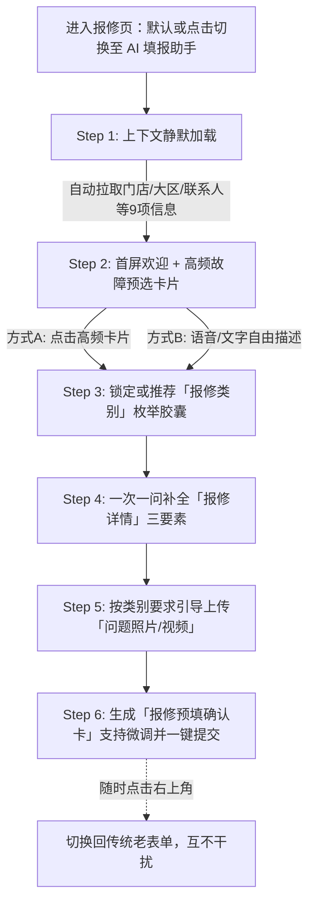

# 设备报修「对话式智能填报 Agent」产品方案

## 一、 核心设计原则

1. **双轨并行，互不干扰**：在现有 App/网页报修页新增「AI 助手填报」悬浮入口或顶部 Tab，保留原传统表单；支持随时一键切换，两边草稿独立、互不覆盖。
2. **AI 预填，人做确认**：AI 负责信息抽取、分类推理与文案润色，最终生成结构化「报修确认卡片」，必须由用户点击【确认提交】后才正式入库。
3. **能查不问，只问该问**：打通账号体系与门店主数据（MDM），自动带出门店及个人基础信息，用户只需聚焦描述“坏了什么”。
4. **一次一问，枚举防幻觉**：对话追问每次只聚焦 1 个缺失项；所有枚举字段必须通过「交互卡片/胶囊按钮」让用户点选，严禁 LLM 自由编造枚举值。
5. **高频预选 + 渐进式追问**：首屏提供高频故障快捷卡片（降低开口成本），选定或输入后，按「类别核对 → 故障详情补全 → 现场照片上传」逐步引导。
6. **防驳回前置校验**：针对易驳回点（如“报修类别选错”、“特定类别照片不合规”），在对话过程中实时拦截并给出拍摄/选择示例。

---

## 二、 表单字段拆解与获取策略

将原 13 个字段重构为 **“系统静默带出（9个） + 枚举强校验（1个） + 对话采集与生成（3个）”**，用户实际交互项从 13 项缩减至 **2~3 步**。

### 1. 系统自动带出（能查不问，共 9 个字段）
> 通过当前登录人 Token 关联员工档案与所属门店主数据自动填充，仅在最终确认卡片中展示（支持手动微调）。

| 字段名称 | 是否必填 | 获取逻辑与默认策略 |
| :--- | :--- | :--- |
| **门店编号** | ✅ 必填 | 依据登录店员绑定门店自动带出（若为督导/巡店员管理多店，首屏弹出门店切换胶囊） |
| **门店名** | ⭕ 选填 | 根据门店编号自动关联带出 |
| **大区** | ✅ 必填 | 根据门店编号从组织架构主数据自动映射（严格匹配系统枚举） |
| **门店属性** | ⭕ 选填 | 根据门店主数据自动带出（如：直营店/加盟店/商场店） |
| **门店地址** | ✅ 必填 | 根据门店主数据自动带出详细地址 |
| **营业时间** | ⭕ 选填 | 根据门店主数据自动带出（便于维修师傅预约上门时间） |
| **联系人** | ✅ 必填 | 默认取当前登录人姓名（确认卡片中支持修改为当班店长/其他人） |
| **手机号码** | ✅ 必填 | 默认 `+86` + 当前登录人手机号（确认卡片中可修改） |
| **报修单编号 / 状态** | ⭕ 系统 | 系统底层自动生成编号；初始流转状态置为 `待提交`，确认后变为 `已提交/待派单` |

### 2. 枚举卡片选择（只能选不能编，共 1 个字段）
> 严禁 AI 自行写入非标文本，必须映射至系统标准字典并由用户点选或确认。

| 字段名称 | 是否必填 | AI 交互与防幻觉策略 |
| :--- | :--- | :--- |
| **报修类别** | ✅ 必填 | **防驳回核心项**。 1. **用户先点高频卡片**：直接锁定对应标准枚举。 2. **用户自由输入描述**：AI 语义匹配最接近的 Top 2~3 个标准枚举，渲染为**单选按钮卡片**请用户点击确认（附带类别说明，防止选错被后台驳回）。 |

### 3. 需要问用户（对话引导采集，共 2 个核心动作）

| 字段名称 | 是否必填 | AI 引导与生成策略 |
| :--- | :--- | :--- |
| **报修详情** | ✅ 必填 | 用户只需口语化吐槽或语音输入，AI 自动检测是否包含**「故障表现、初步原因、影响后果」**三要素；若缺失则一次一问轻量追问，最后由 AI 自动润色拼接成规范长文本。 |
| **问题照片或视频** | ✅ 必填 | 对话中唤起上传组件。**根据已选「报修类别」动态加载拍摄要求**（例如选了“购物袋/耗材”类，强提示需拍外箱批次号+破损特写），上传后可做基础清晰度/数量校验。 |

---

## 三、 产品交互流程（6 步闭环）

### 关键环节说明
1. **Step 1 静默建档**：进入会话瞬间，顶部展示轻量状态条：`📍 已定位：[华东大区] 上海静安寺店 (SH0021) | 联系人：张伟 (138****1234) [修改]`。
2. **Step 2 高频预选卡片**：首屏不让用户面对空白输入框，直接给出门店 Top 6 高频报修卡片（如：`❄️ 冷柜/空调不制冷`、`💻 收银机/扫码枪故障`、`💡 照明/招牌灯不亮`、`🛍️ 购物袋/物料质量问题`、`🚰 水电/下水道堵塞`、`🔧 货架/门锁损坏`）。
3. **Step 3 类别防错锁定**：将口语问题映射为后台标准枚举值，对易混淆类别弹出简短提示（如：“收银软件卡死请走 IT 工单，硬件损坏请选择【设备-收银硬件】”）。
4. **Step 4 详情要素追问**：以“一次一问”方式补齐 **故障表现 → 影响程度（是否影响正常营业）**。
5. **Step 5 场景化附件引导**：根据类别弹出定制化拍照指引卡片，避免因照片不合格被后台驳回重提。
6. **Step 6 预填卡片确认**：汇总所有自动带出字段与 AI 整理字段，用户扫一眼点【确认提交】即可完成。

---

## 四、 真实模拟对话剧本

### 剧本一：常规硬件故障（点击高频卡片 + 一次一问补全）

> **【界面顶部状态栏】**  
> `📍 华东大区 · 上海五角场万达店 (SH0108)` | `👤 李娜 (+86 13912345678)` | `[⇄ 切换传统表单]`

* **🤖 AI 助手**：
  李娜你好！门店信息已自动为你带出。请问店里遇到了什么问题？你可以直接点击下方常见问题，或发语音/文字告诉我：
  > **[快捷卡片]**  
  > `[❄️ 冷柜/空调故障]` `[💻 收银/打印设备]` `[💡 灯具/电路问题]` `[🛍️ 购物袋质量问题]` `[🚪 门头/货架损坏]`

* **👤 店员（点击卡片）**：
  点击了 `[❄️ 冷柜/空调故障]`

* **🤖 AI 助手**：
  收到。为了避免选错类别被后台驳回，请点击确认具体的**【报修类别】**（单选）：
  > **[枚举必选卡片 - 仅限点选]**  
  > - 🔘 `制冷设备 - 风幕柜/立式冷柜` *(放酸奶、鲜奶、饮料的柜子)*  
  > - ⚪ `制冷设备 - 卧式冰柜` *(放雪糕、速冻品的柜子)*  
  > - ⚪ `暖通设备 - 门店中央空调/挂机`

* **👤 店员（点击枚举）**：
  点击选择 `制冷设备 - 风幕柜/立式冷柜`

* **🤖 AI 助手**：
  已锁定类别：`制冷设备 - 风幕柜/立式冷柜`。  
  请问这台冷柜现在**具体是什么症状**？有没有影响柜内商品销售？（可语音直接说）

* **👤 店员（语音转文字）**：
  “就是进门右手边放低温奶的那个风幕柜，今天早上发现温度飙到 15 度了，压缩机一直嗡嗡响不制冷，里面的鲜奶我们已经紧急挪到后仓冷库了，现在那个排面空着没法卖。”

* **🤖 AI 助手**：
  明白，故障表现和影响都很清晰了！  
  最后一步，请上传 **问题照片或短视频**（必填）：建议拍一张**冷柜整体位置图** + 一张**温控器显示 15℃ 的特写**。
  > **[📷 点击拍照 / 上传相册图片或视频]**

* **👤 店员（上传附件）**：
  `[已上传：图片1_温控器15度.jpg]`、`[已上传：视频1_压缩机异响.mp4]`

* **🤖 AI 助手**：
  信息已全部齐备！我已为你整理好规范的报修单，请核对下方卡片，确认无误后点击提交：

  > ### 📋 设备报修预填确认单
  > **【基础信息（系统自动带出）】** `[✏️ 修改基础信息]`
  > - **大区 / 门店**：华东大区 | 上海五角场万达店（`SH0108` · 商场直营店）
  > - **门店地址**：上海市杨浦区淞沪路 77 号万达广场 B1 层 B1022
  > - **营业时间**：10:00 - 22:00
  > - **联系人**：李娜（`+86 13912345678`）
  >
  > **【报修内容（AI 整理预填）】**
  > - **报修类别**：`制冷设备 - 风幕柜/立式冷柜` `[重选]`
  > - **报修详情** `[✏️ 编辑文本]`：  
  >   *【故障表现】进门右侧低温奶风幕柜温控显示异常升高至 15℃，不制冷且伴随压缩机持续异响；*  
  >   *【原因初步判断】疑似压缩机或温控模块故障；*  
  >   *【造成后果】柜内低温鲜奶已紧急转移至后仓冷库暂存，当前前场低温奶排面空置，无法正常陈列销售，急需上门抢修。*
  > - **问题附件**：🖼️ 1 张图片、🎬 1 个视频 `[+ 继续添加]`
  >
  > **[ ✅ 确认并提交报修单 ]**

---

### 剧本二：特殊类别防驳回（自由输入 + 购物袋拍照强校验）

* **👤 店员（进入对话直接打字）**：
  “这批大号购物袋一拎就破，底封线全是裂开的，顾客投诉好几个了，怎么报修？”

* **🤖 AI 助手**：
  识别到你要反馈**购物袋质量问题**。系统匹配到以下标准**【报修类别】**，请点击确认（防止选错被驳回）：
  > **[枚举必选卡片 - 仅限点选]**  
  > - 🔘 `耗材与包装 - 购物袋破损/质量异常` *(正确类别)*  
  > - ⚪ `门店运营设备 - 打包台/封口机故障`

* **👤 店员（点击枚举）**：
  点击选择 `耗材与包装 - 购物袋破损/质量异常`

* **🤖 AI 助手**：
  好的！请问这批出问题的大号购物袋**大约有多少包/多少箱受影响**？店里还有其他批次的袋子能顶替使用吗？

* **👤 店员**：
  “拆了2箱都是这样，还剩5箱没敢拆，现在只能先拿中号袋免费给顾客装两个。”

* **🤖 AI 助手**：
  收到。⚠️ **特别提醒：`[购物袋破损/质量异常]` 类别后台审核极严，缺图会直接驳回！**  
  请按以下要求上传照片或视频（必填）：
  > **📸 购物袋报修必拍清单（请至少上传 2 张）**：  
  > 1. **外箱合格证/批次号特写**（必须看清生产厂家与生产日期）  
  > 2. **购物袋底部开裂处特写**（或手提承重破损短视频）  
  > **[📷 上传外箱批次照]** **[📷 上传破损细节照/视频]**

* **👤 店员（上传附件）**：
  `[已上传：外箱批次码_202610.jpg]`、`[已上传：袋底开裂特写.jpg]`

* **🤖 AI 助手**：
  照片已上传完毕！报修单已为你自动生成，请确认：

  > ### 📋 设备报修预填确认单
  > - **大区 / 门店**：华东大区 | 上海五角场万达店（`SH0108`）
  > - **联系人**：李娜（`+86 13912345678`）
  > - **报修类别**：`耗材与包装 - 购物袋破损/质量异常`
  > - **报修详情** `[✏️ 编辑文本]`：  
  >   *【故障表现】新到货大号购物袋底部封线开裂，一拎即破（已拆封 2 箱均存在该问题，另有 5 箱同批次未拆封）；*  
  >   *【原因初步判断】供应商生产封边工艺不良；*  
  >   *【造成后果】引发多起顾客现场投诉，目前门店只能临时使用中号购物袋替代，大号袋库存无法正常使用，申请批次退换处理。*
  > - **问题附件**：🖼️ 2 张图片（含外箱批次照、破损特写）
  >
  > **[ ✅ 确认并提交报修单 ]**
