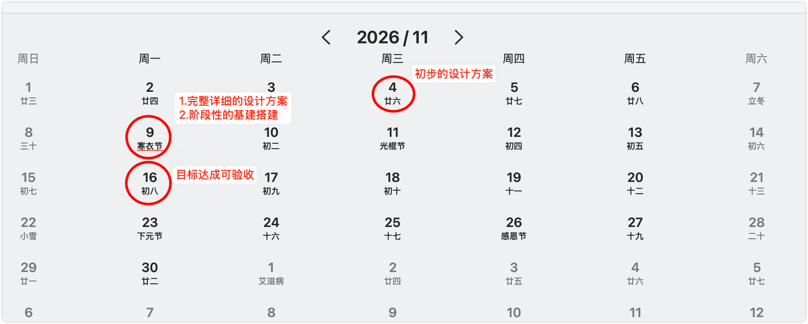

## 1. 背景与产品定位

> 用户通过明道云或app 去执行报修的操作，表单内容繁多且用户不知道如何填写，通过引导对话的方式来实现表单内容的提取

---

## 2、 核心设计点

| # | 原则       | 落地方式 |
|---|----------|----------|
| 1 | 输入方式并行，互不干扰 | 在现有 App/网页报修页新增「AI 助手填报」悬浮入口或顶部 按钮，保留原传统表单；支持随时一键切换，两边草稿独立、互不覆盖。 |
| 2 | AI 预填、人确认 | AI 负责信息抽取、分类推理与，最终生成结构化「报修确认卡片」，必须由用户点击【确认提交】后才正式入库。 |
| 3 | 能查不问、只问该问 | 自动带出门店及个人基础信息，用户只需输入关键信息。(必填缺失、信息冲突、识别不确定、用户输入和枚举不匹配) |
| 4 | 高频预选 + 渐进式追问 | 首屏提供高频故障快捷卡片（降低开口成本），优先输入报修详情（识别报修类别） |
| 5 | 全程可改     | 任意字段点  可改 |

---
## 3、表单字段拆解与获取策略❗❗❗❗❗❗❗（todo 梳理字段来源逻辑和必要性）

将原 13 个字段重构为 **“系统静默带出  + 对话采集与生成 ”**，用户实际交互项从 13 项缩减至 ** 几步**。

### 1. 系统自动可以带出（能查不问）
> 通过当前登录人接口调出 或者前端传入 自动填充，仅在最终确认卡片中展示（支持修改）。

| 字段名称 | 是否必填 | 获取逻辑与默认策略                      |
| :--- | :--- |:-------------------------------|
| **门店编号** | ✅ | 依据登录店员绑定门店自动带出                 |
| **门店名** | ⭕  | 根据门店编号自动关联带出                   |
| **大区** | ✅ | 根据门店编号从组织架构主数据自动映射             |
| **门店属性** | ⭕  | 根据门店主数据自动带出                    |
| **门店地址** | ✅ | 根据门店主数据自动带出详细地址                |

                      |

### 2. 需要ai沟通输入的

| 字段名称        | 是否必填 | 获取逻辑与默认策略 |
| :--- | :--- |:-------------------------------|
| **联系人** | ✅ | 默认取当前登录人姓名（确认卡片中支持修改为当班店长/其他人） |
| **手机号码** | ✅ | 默认 `+86` + 当前登录人手机号（确认卡片中可修改）  |
| **报修详情**    | ✅ | 用户输入      |
| **问题照片或视频** | ✅ | 用户上传      |
| **营业时间** | ⭕  | 根据门店主数据自动带出  或者用户选择填入          |

---

## 三、 产品交互流程

> 完整交互流程图 ）：[产品交互流程图.puml](./产品交互流程图.puml)

### 关键环节说明
1. **初始化**：进入会话瞬间，顶部展示轻量状态条：`📍 已定位：[华东大区] 上海静安寺店 (SH0021) | 联系人：张伟 (138****1234) [修改]`。
2. **高频预选卡片**：首屏不让用户面对空白输入框，直接给出门店 Top 6 高频报修卡片（如：`❄️ 冷柜/空调不制冷`、`💻 收银机/扫码枪故障`、`💡 照明/招牌灯不亮`、`🛍️ 购物袋/物料质量问题`、`🚰 水电/下水道堵塞`、`🔧 货架/门锁损坏`）。
3. **类别获取**：将口语问题映射为后台标准枚举值，对易混淆类别 通过模型去匹配。
4. **预填卡片确认**：汇总所有自动带出字段与 AI 整理字段，用户扫一眼点【确认提交】即可完成。

---

## 四、 模拟对话剧本

> AI 只采集表单内字段（报修类别、报修详情、联系人、手机号），不追问表单以外的信息。

###  分支A：先自由描述问题（AI 识别设备与详情）

> **【界面顶部状态栏】**
> `📍 已定位：[华东大区] 上海静安寺店 (SH0021) | 联系人：张伟 (138****1234) [修改]` | `[⇄ 切换传统表单]`

* **🤖 AI 助手**：
  张伟你好！门店信息已自动带出。请描述这次的问题：**故障设备是什么、具体表现、产生原因、导致后果**，想到什么说什么（支持语音）。

* **👤 店员（语音转文字）**：
  “店里的冷藏风幕柜不制冷了，柜内温度显示 15 度，估计是压缩机坏了，里面的鲜奶不敢卖只好全下架了。”

* **🤖 AI 助手**：
  已从描述中识别故障设备。**【报修类别】**将登记为以下枚举（请点选确认，防止误报被驳回）：
  > **[枚举确认卡片 - 仅限点选]**
  > - 🔘 `制冷设备 - 风幕柜/立式冷柜` *（AI 根据你的描述识别）*
  > - ⚪ `制冷设备 - 卧式冰柜`
  > - ⚪ `暖通设备 - 门店空调`

* **👤 店员（点击枚举）**：
  点击确认 `制冷设备 - 风幕柜/立式冷柜`

* **🤖 AI 助手**：
  类别已登记。**联系人 / 手机号码**将使用系统带出的本人信息：张伟（`+86 138****1234`），如替他人报修可修改：
  > `[✅ 用本人信息]`｜`[✏️ 修改联系人]`

* **👤 店员（点击）**：
  点击 `[✅ 用本人信息]`

* **🤖 AI 助手**：
  信息齐了，报修详情已按表单要求整理为草稿，请核对：
  > ### 📋 设备报修预填确认单
  > **【基础信息（系统自动带出）】** `[✏️ 修改基础信息]`
  > - **大区 / 门店**：华东大区 | 上海静安寺店（`SH0021` · 商场店）
  > - **门店地址**：上海市静安区南京西路 1618 号 B1 层
  > - **营业时间**：10:00 - 22:00
  > - **联系人**：张伟（`+86 138****1234`）
  >
  > **【报修内容（AI 识别 + 整理预填）】**
  > - **报修类别**：`制冷设备 - 风幕柜/立式冷柜` `[重选]`
  > - **报修详情** `[✏️ 编辑文本]`：
      >   *【故障表现】冷藏风幕柜不制冷，柜内温度显示 15℃；*
      >   *【产生原因】初步判断压缩机故障；*
      >   *【导致后果】柜内鲜奶已全线下架，无法正常销售。*
  >
  > **[ ✅ 确认并提交报修单 ]**

* **👤 店员（点击提交）**：
  点击 `[✅ 确认并提交报修单]`

* **🤖 AI 助手**：
  提交成功 ✅ 报修单编号：`BX-20261031-1032`，状态：**已提交 / 待派单**。维修进度会推送通知你。

---

## 五、 兜底方案

| 场景       | 兜底策略                           |
|----------|--------------------------------|
| 类别匹配失败   | AI 不猜枚举：降级为 top几选择  或 其他       | 
| AI 服务不可用 | 聊天入口降级提示「暂不可用」，自动引导回老表单，绝不阻塞报修 |

## 六、 度量指标 好不好的分析纬度

| 指标        | 定义与采集方式                  |  
|-----------|--------------------------| 
| 填报时长和步数   | 从进入 AI 会话到提交成功的耗时和完成的步数  |   
| 报修执行完成成功率 | 是否有卡壳，失败案例               |      
| 类别识别准确率   | 方式A中 AI 识别类别与用户最终确认类别的一致 |
| AI 入口渗透率  | AI 填报单量 / 总报修单量          |     
| 转老表单率     | 进入 AI 会话后切回老表单的占比        |

---

## 七、 实施计划

| 时间 | 里程碑 | 交付物 | 验收标准 |
|---|---|---|---|
| **11.4（周三）** | 技术设计方案 | 系统架构图（前端 ↔ AI 服务 ↔ MCP 工具 ↔ 明道云 API）、MCP 工具清单、对话状态机设计、埋点清单 | 评审通过；真实报修类别枚举清单与接口权限确认到位 |
| **11.9（周一）** | ① 阶段性基建搭建 ② 完整详细设计方案 | ① MCP server 骨架，门店/枚举查询、工单提交三类工具联调可用，会话草稿存储打通 ② 字段级交互稿 + 全分支剧本 + 兜底逻辑清单 | 三类工具接口联调通过；设计方案覆盖 13 个字段全部获取策略 |
| **11.16（周一）** | 目标达成，可验收 | 端到端可演示版本 | 双分支（自由描述 / 高频卡片）对话 → 预填确认 → 提交入库全流程走通；兜底路径至少演示 2 条；度量埋点正常上报 |

