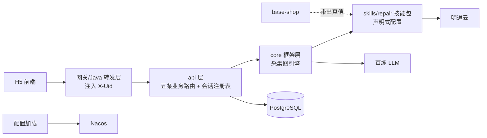

# 系统总览

描述对象:整个 app/ 包(装配入口 app/main.py)。

AgentServerCenter 是一个同步 JSON 的 HTTP 服务:门店员工在 H5 页面里用对话加卡片的方式填报「设备报修单」,服务端用大模型识别口语、用确定性流程管采集、由人确认后写入明道云工单系统。一个部署单元承载多个业务技能包,当前只装了「报修」一个包;框架层(app/core/)不含任何报修业务词汇,新业务以新技能包接入,框架零改动(有一条测试守着这条边界)。

核心分工一句话:LLM 负责识别与生成,程序负责流程,人负责确认。

## 边界

进:五条业务路由(前缀 /agent/repair/v1,见 api-reference.md)加两条探针(/healthz、/readyz);身份完全信任上游网关注入的 X-Uid 头,服务自身零鉴权,缺头一律 401。出:五个外部依赖(见 integrations.md):百炼大模型、明道云、base-shop 主数据、Nacos 配置中心、PostgreSQL。

不做什么:不处理工单后续流转(派单后归明道云工作流)、不做多副本水平扩展(会话互斥锁与建单幂等缓存都在进程内,扩容前需先落 PG advisory lock)、不设 CORS(只经网关同源暴露)。

## 分层与依赖

三层结构,依赖方向单向:api 层依赖 core 层与技能包,core 层不依赖任何技能包(技能包依赖 core 的契约类型)。

(图源见 diagrams/overview.dep.mermaid;base-shop 与明道云的实际调用点在技能包工具内,框架只认工具接口形状。)

各层职责:

- api 层(app/api/):请求校验(口径全读技能包声明)、身份闸门、会话互斥、终态归档触发。
- core 框架层(app/core/):采集图引擎、技能包契约、LLM 网关、降级规则脑、PG 会话基建、敏感值掩码、外部客户端。
- 技能包层(app/skills/repair/):七份声明式配置(槽位、话术、字典、工具、卡片),启动时自检,配错拒绝启动。

## 一轮对话怎么走(速览)

细节在 processes.md。用户消息进来后:结构化手势(点卡、点选、上传)零 LLM 直达写槽;打字消息走一次 LLM 联合抽取(意图加字段增量),过六道闸门后才写槽;议程(待问必填槽)按声明顺序逐项清空,清空即组确认单;提交时全量重校验加包级校验,过了才建单;连续边界轮(跑题、识别失败)达阈值就降级为纯卡片向导,同样能交单。

## 运行形态

单进程 uvicorn,同步端点跑在线程池(默认容量内,见 config-reference.md 容量口径);会话状态在检查点后端二选一:memory(进程内,重启丢会话,零依赖)或 postgres(检查点加活跃索引加归档表同库,重启不丢)。Docker 镜像以非 root 构建,构建期用上班身份跑一次技能包自检;健康检查用 /readyz(依赖齐才转绿),活体用 /healthz。
